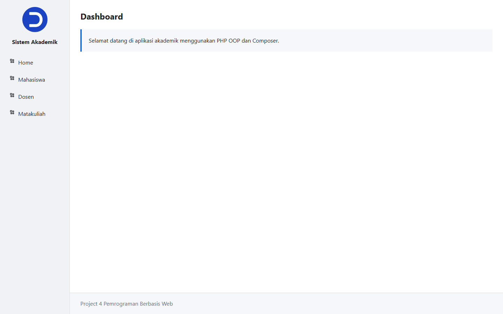
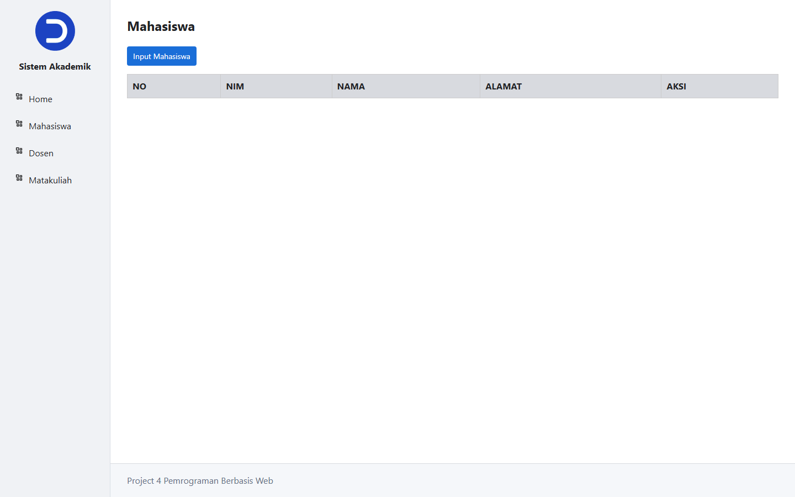
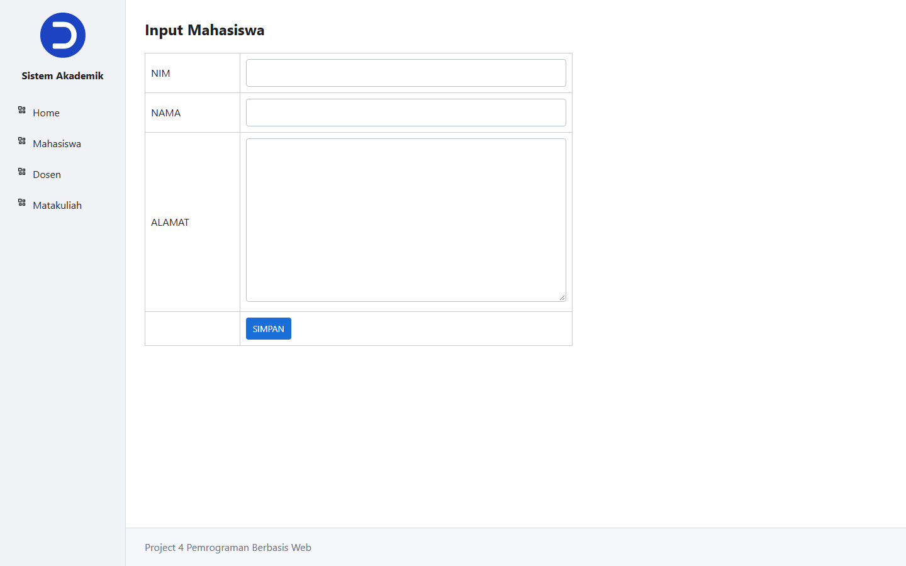
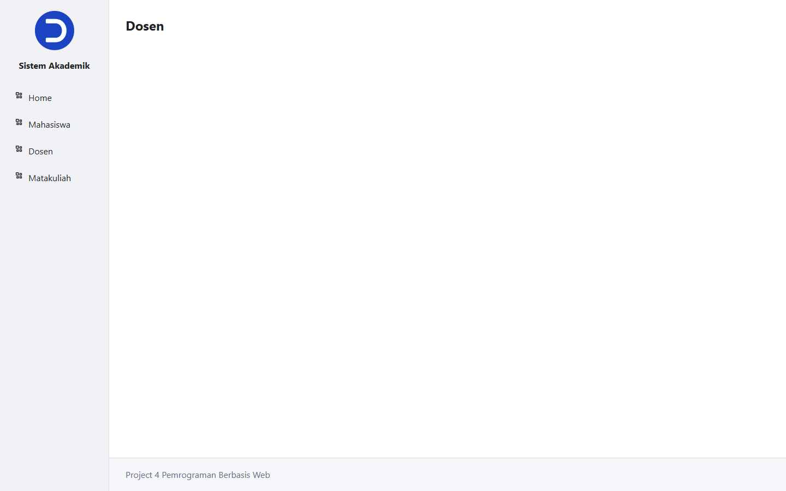
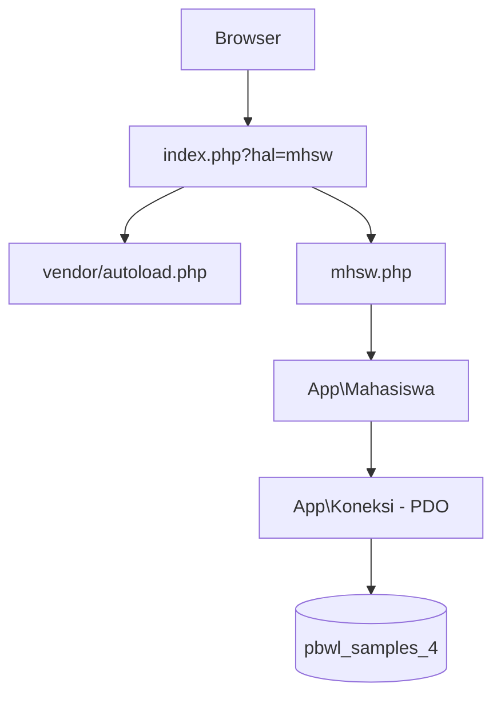

<div align="center">

# 🧩 Sistem Akademik — Project 4

**Project 4 · PHP OOP + Composer**

Sistem Akademik PHP OOP yang sudah memakai **Composer autoload (PSR-4)** dan layout terpisah.

     

</div>

---

## 📖 Deskripsi

`composer.json` memetakan namespace `App\` ke folder `app/`. File `vendor/autoload.php` dimuat di `index.php`, sehingga class dimuat otomatis tanpa `require` manual. Routing memakai parameter `?hal=`.

## 📸 Tampilan

<table>
  <tr>
    <td width="50%"><br><sub>Dashboard</sub></td>
    <td width="50%"><br><sub>Daftar Mahasiswa</sub></td>
  </tr>
  <tr>
    <td width="50%"><br><sub>Form Input</sub></td>
    <td width="50%"><br><sub>Daftar Dosen</sub></td>
  </tr>
</table>

## ✨ Fitur

- ⚙️ Autoload PSR-4 via Composer (`App\` → `app/`)
- 📋 CRUD mahasiswa penuh
- 👨‍🏫 Data dosen & 📚 matakuliah
- 🧭 Routing `index.php?hal=...`
- 🎨 Layout/ui terpisah di `layouts/`
- 📦 `vendor/` sudah disertakan (langsung jalan)

## 🧱 Teknologi

| Lapisan | Teknologi |
| --- | --- |
| Bahasa | PHP 8.0+ (OOP + namespace) |
| Autoload | Composer PSR-4 |
| Database | MySQL (PDO) |
| Routing | `?hal=` |
| Tampilan | HTML + CSS di `layouts/` |

## 🏗️ Arsitektur



## 🚀 Instalasi

1. Letakkan di `htdocs`.
2. Import `database.sql` ke `pbwl_samples_4`.
3. Buka **http://localhost/pbwl-samples-4/**.

Jika `vendor/` hilang: `composer install`.

## 🗂️ Struktur

```
pbwl-samples-4/
├── app/
│   ├── Mahasiswa.php
│   └── Koneksi.php
├── inc/
├── layouts/
├── vendor/              # autoload Composer
├── composer.json
├── database.sql
├── index.php            # router ?hal=
├── mhsw*.php, dosen.php, matkul.php
└── README.md
```

## 🗄️ Database

Database **`pbwl_samples_4`** di MySQL/MariaDB port **3307** (user `root`, password kosong).

File `database.sql` sudah diimpor. Jika perlu import ulang:

```bash
mysql -h 127.0.0.1 -P 3307 -u root pbwl_samples_4 < database.sql
```

> Database lain di XAMPP (termasuk `dbakademik`) sengaja tidak disentuh.

## ✅ Verifikasi

- `/` → 200
- `/index.php?hal=mhsw` → 200
- `/index.php?hal=dosen` → 200

## 🔗 Tautan

- GitHub: https://github.com/Neuron700/pbwl-samples-4
- Aplikasi: http://localhost/pbwl-samples-4/

## 📄 Lisensi

MIT
